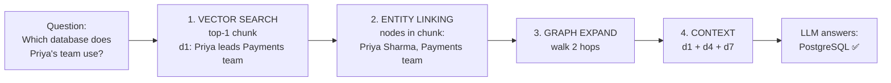
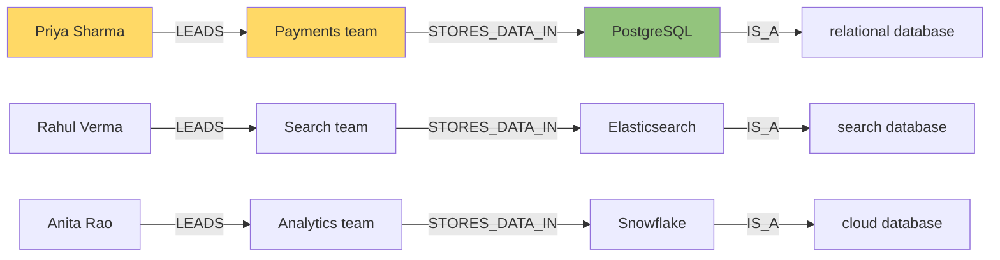

# Mini Hybrid RAG: Graph + Vector in ~250 lines (half of them comments)

A tiny, fully offline project that teaches **one concept**:

> **Vector search finds text that is *similar* to your question.
> A graph finds facts that are *connected* to it.
> Hybrid RAG uses vectors to find a starting point, then the graph to follow the connections.**

No database servers, no API keys, no model downloads. 10 sentences of data, two scripts, runs in a second.

---

## The problem: multi-hop questions

Our knowledge base is 10 short sentences about a fictional company. Two of them are:

```
[d1] Priya Sharma leads the Payments team.
[d4] The Payments team stores all transactions in PostgreSQL.
```

Question: **"Which database does Priya's team use?"**

A human connects the two: *Priya → Payments team → PostgreSQL*. No single sentence contains the answer, though. You need **two hops**.

### What plain vector RAG does (`step1_vector_only.py`)

It scores every chunk by word/meaning overlap with the question:

```
[ d1] 0.503  Priya Sharma leads the Payments team.          <-- needed
[ d9] 0.270  Snowflake is a cloud database.
[ d7] 0.197  PostgreSQL is an open-source relational database.
[ d8] 0.185  Elasticsearch is a search database ...
 ...
[ d4] 0.110  The Payments team stores all transactions in PostgreSQL.  <-- needed (rank 7!)
```

Top 2 = `d1` + `d9` → the LLM sees "Priya leads Payments" and "Snowflake is a database" and answers **Snowflake**, which is confidently wrong.

`d4` is the bridge, but it mentions neither "Priya" nor "database", so it looks *irrelevant* to similarity search. **Similarity ≠ connection.**

### What hybrid RAG does (`step2_hybrid.py`)



The graph built from the same 10 sentences:



Starting at the yellow nodes (found via vector search), one hop reaches **PostgreSQL**. Every edge remembers the sentence it came from (`d4`), so we put that sentence in the LLM context.

Output:

```
1) VECTOR SEARCH (entry point)
   [d1] score=0.503  Priya Sharma leads the Payments team.
2) ENTITY LINKING -> start nodes: ['Priya Sharma', 'Payments team']
3) GRAPH EXPANSION (2 hops) -> facts walked:
   (Priya Sharma) -[LEADS]-> (Payments team)          from d1
   (Payments team) -[STORES_DATA_IN]-> (PostgreSQL)   from d4
   (PostgreSQL) -[IS_A]-> (relational database)       from d7
4) CONTEXT that would be sent to the LLM:
   [d1] Priya Sharma leads the Payments team.
   [d4] The Payments team stores all transactions in PostgreSQL.
   [d7] PostgreSQL is an open-source relational database.
RESULT: PASS
```

---

## Who does what

| Part | Job | Good at | Bad at |
|---|---|---|---|
| **Vector store** | "Which chunks *sound like* the question?" | Fuzzy matching, synonyms, finding a starting point | Following relationships between chunks |
| **Graph store** | "What is *connected* to this thing?" | Multi-hop reasoning, exact relationships | Understanding free-text questions |
| **Hybrid** | Vector picks the entry point, graph walks from there | Both | More moving parts (you must build the graph) |

---

## Files

| File | What it is | Lines |
|---|---|---|
| `data.py` | 10 documents + the facts (triples) extracted from them | ~45 |
| `vector_store.py` | TF-IDF vectors + cosine similarity search | ~30 |
| `graph_store.py` | networkx graph, entity linking, N-hop expansion | ~45 |
| `step1_vector_only.py` | Plain RAG, which fails | ~45 |
| `step2_hybrid.py` | Hybrid RAG, which works | ~65 |

## Run it

```bash
pip install -r requirements.txt
python step1_vector_only.py   # see the failure
python step2_hybrid.py        # see the fix
```

Optional: `pip install anthropic`, set `ANTHROPIC_API_KEY`, and `step2_hybrid.py` will also ask a real LLM using the retrieved context.

---

## How this maps to the "real" big project

Everything here is a deliberately small stand-in for a production component:

| This project | Production equivalent |
|---|---|
| TF-IDF vectors (`scikit-learn`) | Neural embeddings (OpenAI, sentence-transformers, Cohere) |
| Python list of vectors | Vector DB: Chroma, pgvector, Qdrant, Pinecone, Oracle 23ai Vector Search |
| Hand-written `TRIPLES` | LLM extracts (entity, relation, entity) from every chunk |
| `networkx` in memory | Graph DB: Neo4j, Amazon Neptune, Oracle Property Graph |
| String-match entity linking | NER model or LLM maps text to graph nodes |
| Print the context | Send context + question to the LLM |

The **flow stays the same**: embed → search → link entities → expand graph → build context → generate.

---

## Exercises (to check you've got it)

1. **Break the vector search more.** Set `TOP_K = 5` in `step1_vector_only.py`. Is `d4` retrieved now? (No: it's rank 7. More chunks means more noise, not more connections.)
2. **Change the hop count.** Set `HOPS = 1` in `step2_hybrid.py`. Which fact disappears, and is the answer still correct?
3. **Ask a new question.** Change `QUESTION` to `"What does Anita's team run reports on?"`. Does hybrid still work without changing any code?
4. **Add a fact.** Add the document `"Priya Sharma reports to Rahul Verma."` and the triple `("Priya Sharma", "REPORTS_TO", "Rahul Verma", "d11")`. Run step 2. What new (possibly irrelevant) context appears? That is the main risk of graph expansion: **too many hops pull in noise.**
5. **Real embeddings.** Swap TF-IDF for `sentence-transformers` (`all-MiniLM-L6-v2`). Does vector-only RAG still fail? (Usually yes. Better embeddings improve similarity, but they still can't follow a link.)

## Key takeaway

**Vector search answers "what is this about?" A graph answers "what is this connected to?"** Multi-hop questions need the second one, so hybrid RAG uses vectors to find the door and the graph to walk through the house.
